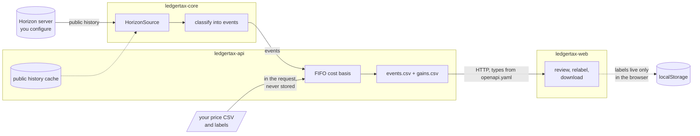

# Stellar Ledger Tax

Turns the public history of Stellar addresses into classified events, FIFO cost-basis results and CSV reports.

**Accounting export, not tax advice.** Tax rules differ by country, classification can be wrong, and a wrong price gives a wrong result.

**Status:** early, working end to end on testnet. The core library is published to npm as [`@veronicdev/ledgertax-core`](https://www.npmjs.com/package/@veronicdev/ledgertax-core); the api and web app are not deployed. The tool is read-only: it never holds keys or sends transactions. See [docs/DEMO.md](docs/DEMO.md) for what was verified and what was not.

## Packages

| Folder | Purpose | Check |
|---|---|---|
| [`ledgertax-core/`](https://github.com/Ledger-Tax/ledgertax-core) | Library: fetch history through a pluggable source (Horizon), classify operations into typed events | 93 tests |
| [`ledgertax-api/`](https://github.com/Ledger-Tax/ledgertax-api) | Backend: cost basis (FIFO), price file handling, CSV reports, HTTP API | 107 tests |
| [`ledgertax-web/`](https://github.com/Ledger-Tax/ledgertax-web) | Next.js app: enter an address, review and relabel events, supply prices, download reports | 56 tests |

Each folder installs, builds, tests and lints by itself: `pnpm install --frozen-lockfile && pnpm lint && pnpm typecheck && pnpm test && pnpm build`.

## How it fits together

Dependency direction: core, then api, then web. Never the reverse.

## What it does and does not do

- Classifies payments, trades (including offers filled by someone else), path payments, fees, account creation and merges, claimable-balance claims. Anything else becomes an `unknown` event that is shown, never hidden.
- A payment in is not income and a payment out is not a sale unless you label it. A missing price is an error row, not a guess.
- History completeness depends on the Horizon server: the public SDF Horizon keeps about one year. Every report states the source and range it used.
- Not covered: liquidity pools, Soroban contract events, several linked addresses, cost-basis methods other than FIFO, external price sources, other export formats. These are the planned contributor issues, drafted in [docs/wave-issues/](docs/wave-issues).

## Project files

| File | What it is |
|---|---|
| [AGENTS.md](AGENTS.md), [PLAYBOOK.md](PLAYBOOK.md), [STATUS.md](STATUS.md) | How the work was specified, run and where it stands |
| [docs/RESEARCH.md](docs/RESEARCH.md) | What data sources exist and what was verified about them |
| [docs/DEMO.md](docs/DEMO.md) | End-to-end run and the independent check of the gains |
| [docs/WAVE_APPLICATION.md](docs/WAVE_APPLICATION.md) | Checklist for you before publishing |
| [docs/USER_ACTIONS.md](docs/USER_ACTIONS.md) | The remaining steps only you can do, in order |

## For an agent starting work

1. Read [AGENTS.md](AGENTS.md), then [STATUS.md](STATUS.md), then the current phase in [PLAYBOOK.md](PLAYBOOK.md).
2. Stop at the points AGENTS.md lists (publishing, deploying, paid services, anything outside the folder).
